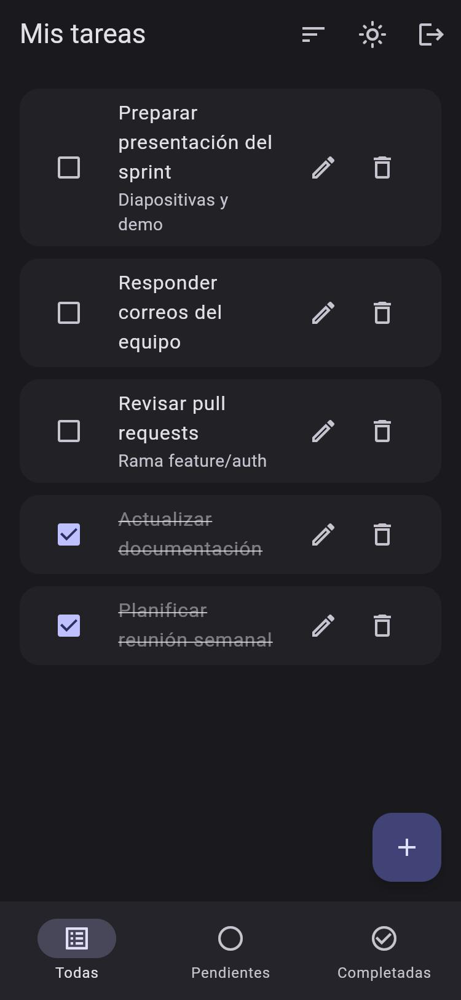
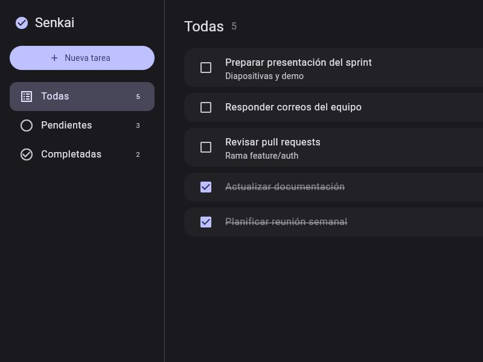

# Senkai

A cross-platform task manager with email authentication and a cloud database. It ships two distinct layouts from a single codebase — a mobile view with bottom navigation and a desktop view with a sidebar — and syncs through Supabase with row-level security per user.

**Live demo:** [taskapp-orcin-zeta.vercel.app](https://taskapp-orcin-zeta.vercel.app)

| Mobile | Desktop |
|---|---|
|  |  |

## Features

- Email and password sign up and sign in, with a persistent session
- Task CRUD with optimistic updates (the UI reacts instantly, then reverts on failure)
- Filter by all / pending / completed and sort by date, title or pending-first
- Responsive: bottom navigation on phones, a sidebar with counts on desktop
- Light and dark themes, remembered across launches
- Loading, empty and error states with retry and inline feedback

## Stack

- Flutter (Dart)
- Supabase — authentication, PostgreSQL and row-level security
- `shared_preferences` for the theme setting

## Architecture

```
lib/
├── config/        Supabase initialization
├── controllers/   TaskController (state) and ThemeController
├── models/        Task model
├── services/      Auth and task services (Supabase calls)
├── widgets/       TaskList, TaskTile, task editor
└── screens/       Login, register and the responsive home
```

State lives in a `ChangeNotifier` controller shared by both layouts, so the mobile and desktop views render the same data and logic.

## Requirements

- Flutter SDK ^3.12.2
- A Supabase project with email auth enabled

## Setup

Credentials are passed at build time with `--dart-define`, so there is no `.env` bundled into the app. For local development, copy the example config and fill it in:

```bash
git clone https://github.com/Sagudelo01/task_app.git
cd task_app
flutter pub get
cp env.example.json env.json   # then edit env.json with your Supabase values
```

Create the `tasks` table and its row-level security policies in the Supabase SQL editor:

```sql
CREATE TABLE tasks (
  id UUID DEFAULT gen_random_uuid() PRIMARY KEY,
  user_id UUID REFERENCES auth.users(id) ON DELETE CASCADE NOT NULL,
  title TEXT NOT NULL,
  description TEXT,
  is_completed BOOLEAN DEFAULT false,
  created_at TIMESTAMPTZ DEFAULT now()
);

ALTER TABLE tasks ENABLE ROW LEVEL SECURITY;

CREATE POLICY "Users read their own tasks"   ON tasks FOR SELECT USING (auth.uid() = user_id);
CREATE POLICY "Users create their own tasks" ON tasks FOR INSERT WITH CHECK (auth.uid() = user_id);
CREATE POLICY "Users update their own tasks" ON tasks FOR UPDATE USING (auth.uid() = user_id);
CREATE POLICY "Users delete their own tasks" ON tasks FOR DELETE USING (auth.uid() = user_id);
```

## Running

```bash
flutter run -d chrome --web-port=3000 --dart-define-from-file=env.json
```

The fixed port 3000 must match the Site URL set in Supabase so email confirmation resolves correctly.

Production web build (WasmGC renderer, with a JavaScript fallback):

```bash
flutter build web --release --wasm --dart-define-from-file=env.json
```

## Tests

```bash
flutter test
```

Covers the task controller: loading, create, optimistic toggle and delete, filtering and sorting.
