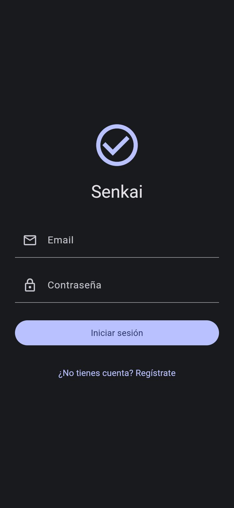

# Senkai

A cross-platform task manager with email authentication and a cloud database. Sign in, manage your tasks and filter them by state; data syncs through Supabase with row-level security per user.

**Live demo:** [taskapp-orcin-zeta.vercel.app](https://taskapp-orcin-zeta.vercel.app)



## Features

- Email and password sign up and sign in
- Persistent session
- Task CRUD: create, edit, complete and delete
- Filters: all, pending, completed
- Material 3 dark theme

## Stack

- Flutter (Dart)
- Supabase — authentication, PostgreSQL and row-level security

## Requirements

- Flutter SDK ^3.12.2
- A Supabase project with email auth enabled

## Setup

Install dependencies:

```bash
git clone https://github.com/Sagudelo01/task_app.git
cd task_app
flutter pub get
```

Copy the env file and fill it with your Supabase project values:

```bash
cp .env.example .env
```

```
SUPABASE_URL=https://your-project.supabase.co
SUPABASE_ANON_KEY=your_publishable_key
```

The keys are bundled at build time, so rebuild after changing `.env`.

Create the `tasks` table and its row-level security policies in the Supabase SQL editor:

```sql
CREATE TABLE tasks (
  id UUID DEFAULT gen_random_uuid() PRIMARY KEY,
  user_id UUID REFERENCES auth.users(id) ON DELETE CASCADE NOT NULL,
  title TEXT NOT NULL,
  description TEXT,
  is_completed BOOLEAN DEFAULT false,
  created_at TIMESTAMPTZ DEFAULT now()
);

ALTER TABLE tasks ENABLE ROW LEVEL SECURITY;

CREATE POLICY "Users read their own tasks"   ON tasks FOR SELECT USING (auth.uid() = user_id);
CREATE POLICY "Users create their own tasks" ON tasks FOR INSERT WITH CHECK (auth.uid() = user_id);
CREATE POLICY "Users update their own tasks" ON tasks FOR UPDATE USING (auth.uid() = user_id);
CREATE POLICY "Users delete their own tasks" ON tasks FOR DELETE USING (auth.uid() = user_id);
```

## Running

```bash
flutter run -d chrome --web-port=3000
```

The fixed port 3000 must match the Site URL set in Supabase so email confirmation resolves correctly.

Production build:

```bash
flutter build web --dart-define=SUPABASE_URL=your_url --dart-define=SUPABASE_ANON_KEY=your_key
```

## Project structure

```
lib/
├── main.dart     app entry point and theme
├── config/       Supabase configuration
├── models/       Task model
├── services/     auth and task services
└── screens/      login, register, home
```
